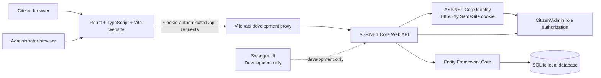

# Emergency112 architecture

Incident writes and reads are server-owned. The browser does not keep an authoritative copy in localStorage. Citizen incident queries are scoped to the authenticated user in the API. Admin controllers require the Admin role regardless of frontend navigation guards.

Response units and status updates exist only as local simulation records. No API integration to phone networks, SMS providers, dispatch systems, government systems, or real responder organizations is present. The separate `tel:` link in the assistance page opens only after an explicit click and uses the placeholder configured in `src/config.ts`.
