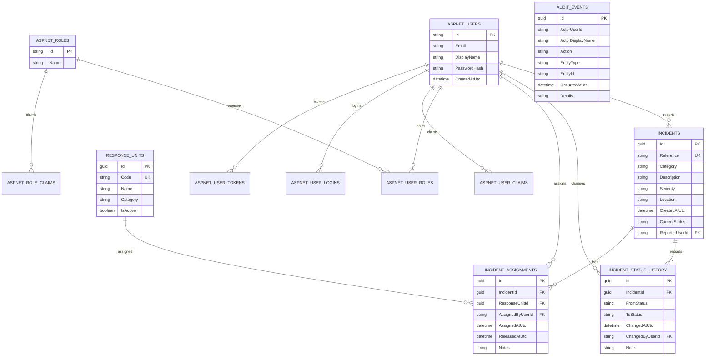

# Database relationships

An incident reference is unique. Deleting an unreviewed incident cascades its status/assignment records; response unit and user references are restricted from deletion while referenced. Audit events capture administrator changes without copying incident descriptions or location into the audit log. `ActorUserId` is retained as a historical text value so audit records remain readable if an account is later removed.
